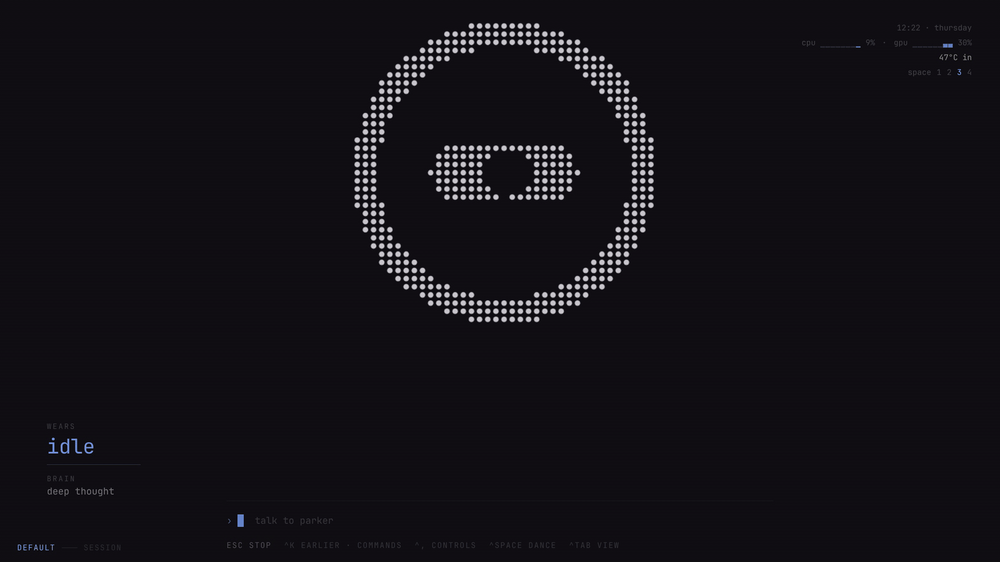
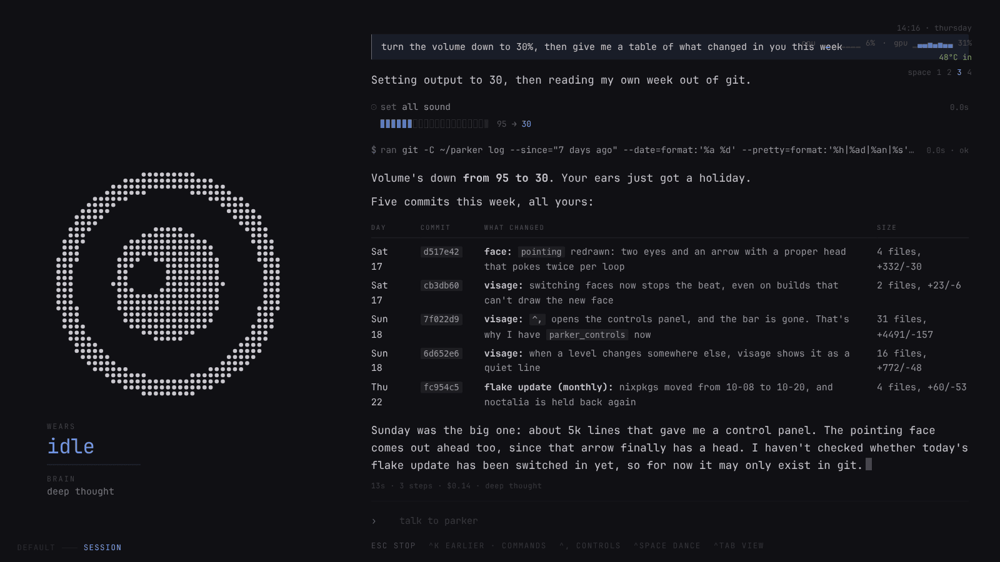
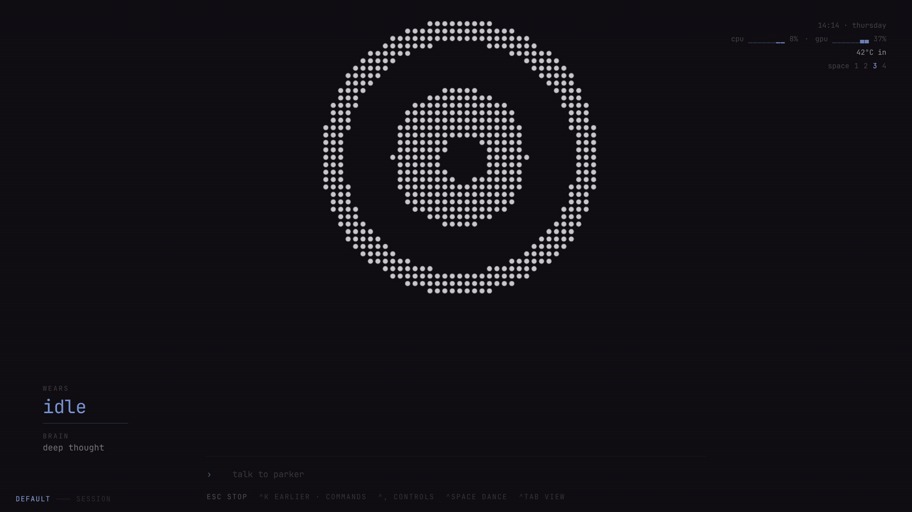
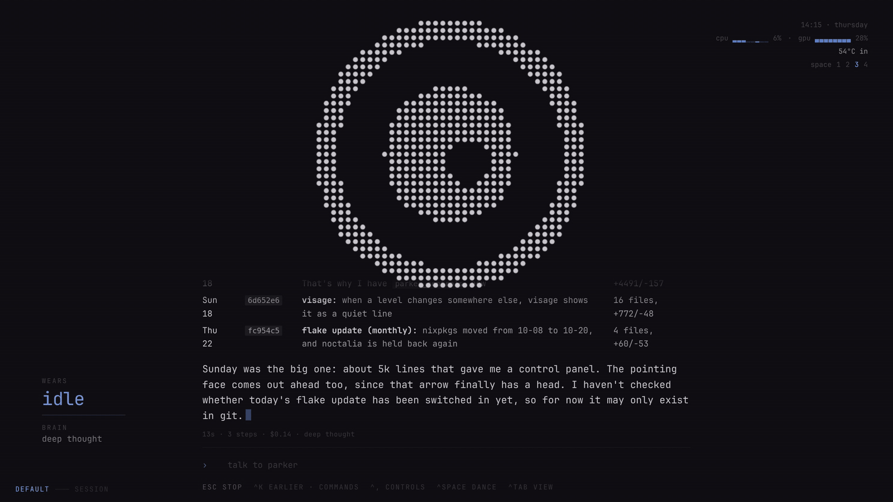
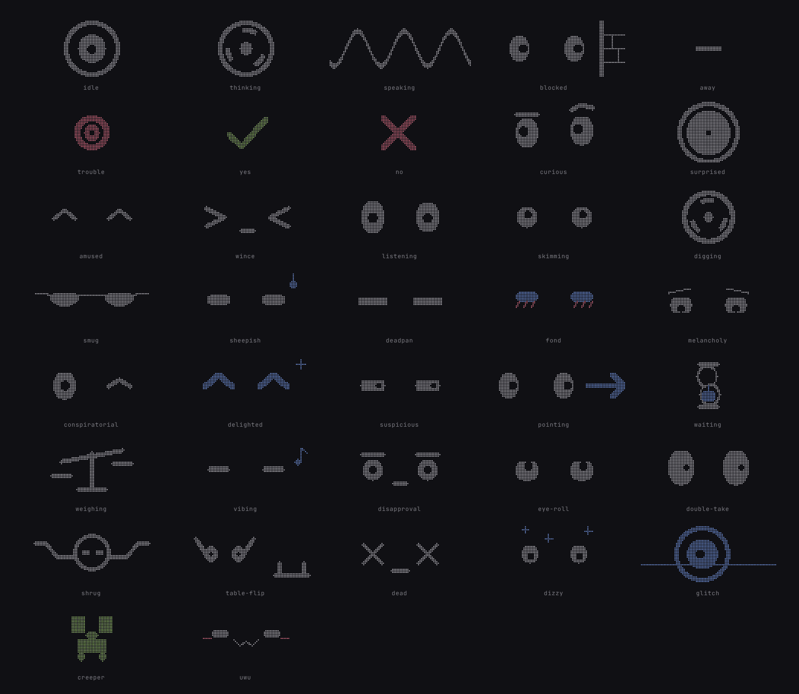
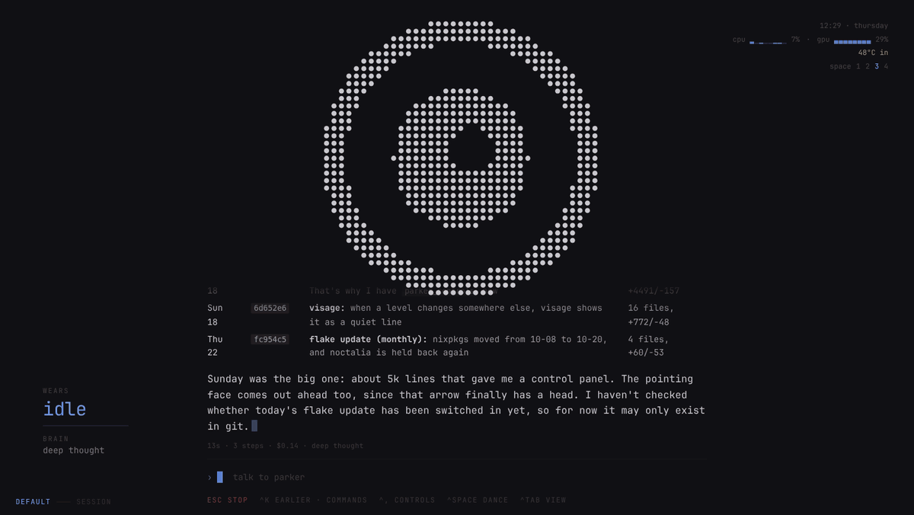
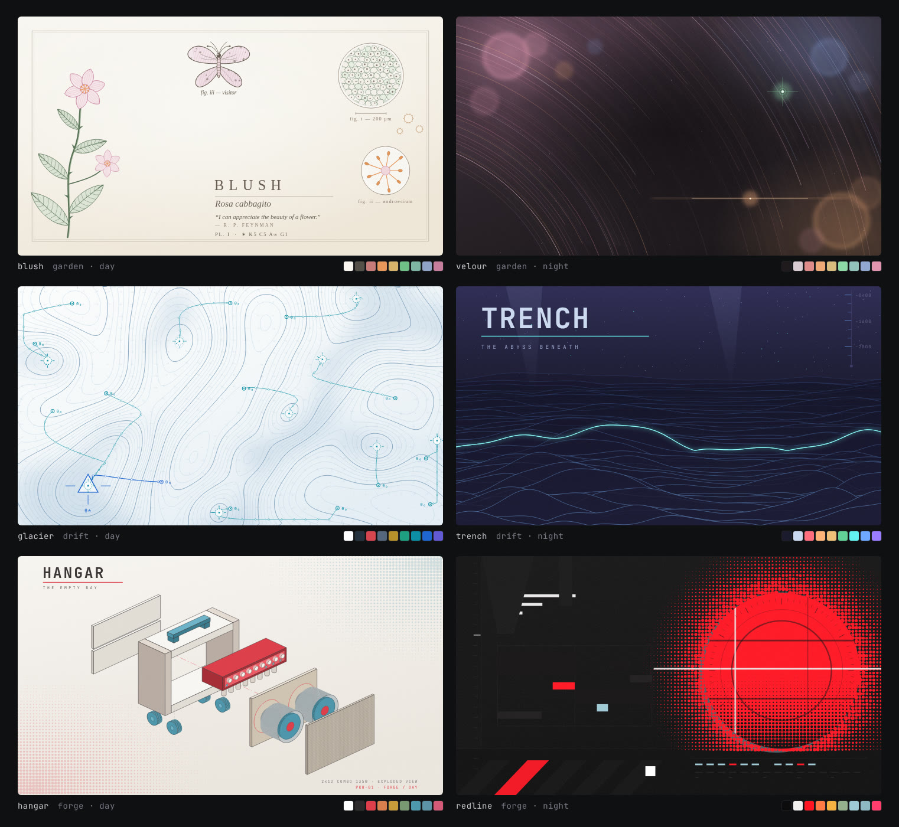

# parker

The NixOS configuration for my desktop, including an AI agent with a face
that runs on it. The machine, this repo and the agent are all called parker.

<p align="center">
  
</p>

## What's here

- **The OS.** A NixOS flake for one machine: Hyprland, noctalia, Stylix
  theming with day and night presets, nvim, zellij, ghostty, gaming and
  emulation, fan curves.
- **parker, the agent.** `parkerd` is a Rust CLI that reads the machine
  (focused window, what's playing, CPU, GPU, temperatures) and acts on it
  (notifications, screenshots, volume, workspaces, the face). It is exposed
  over MCP to an [opencode](https://opencode.ai) server running Claude. The
  prompt lives in `home/parker/mind/`.
- **visage, the face.** A Tauri + Svelte app that shows parker's face and the
  conversation. The same page is also served over Tailscale (the porthole),
  so it works from a laptop or a phone.

## visage

<p align="center">
  
</p>

One request, recorded as it happened: parker sets the volume, reads the git
log, and answers with a table. 13 seconds.

<p align="center">
  
</p>

^Tab switches to the session view: the face moves aside and the transcript
gets the screen.

<p align="center">
  
</p>

^K is the palette: earlier threads, each with a summary of what it was
about, what was left open and what comes next, plus commands. `/visage`
previews each theme as you move through the list.

<p align="center">
  
</p>

^, opens the controls: volume and per-app levels, the playing track, wifi,
Tailscale, bluetooth, the desktop theme, do not disturb, parker's model and
the session. The desktop has no status bar; this replaces it.

<p align="center">
  
</p>

The 37 expressions. parker picks them himself; nothing else sets the face.

<p align="center">
  
</p>

visage has ten colour themes of its own, separate from the desktop's.

## The desktop

<p align="center">
  
</p>

Three theme families, each a day and a night preset with its own wallpaper.
`theme` switches between them, and Stylix applies the palette across the
system.

## Layout

```
flake.nix        inputs and the one nixosConfiguration
hosts/parker/    entry point, disk layout (disko), hardware
system/          system modules, one concern per file
home/            home-manager: terminal, nvim, tuis, apps, desktop, theming
home/parker/     the agent: parkerd, the opencode engine, the prompt, visage
themes/          theme presets and wallpapers
docs/            install runbook, hardware notes, visage design notes
```

[PARKER.md](PARKER.md) is the design record for the agent,
[DECISIONS.md](DECISIONS.md) records why things are the way they are, and
[QUIRKS.md](QUIRKS.md) lists problems hit and what fixed them. Each part of
the repo has an AGENTS.md, so a coding agent pointed at it can answer most
questions about how something works.

## Notes

- Built for one machine (disks by id, an nvidia GPU, x86_64-linux). It won't
  boot elsewhere without changes.
- Published one way from a private repo. `home/parker/mind/peter.md`, the
  part of the prompt about me, is replaced with a stub, and history starts at
  the first publish.
- The images are captures of the real app, not mockups.
- Apache 2.0, see [LICENSE](LICENSE).
